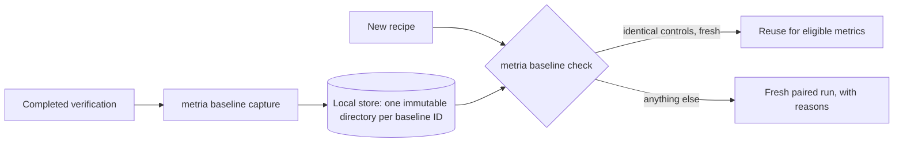

# Reference baselines

!!! note "Unreleased, staged"
    `metria baseline` is on `main` and ships in the next release after 0.1.7.
    This first step stores baselines and decides eligibility. `metria verify`
    still runs both sides; reusing a stored reference in place of a fresh run
    comes in a later step.

A paired verification runs the reference and the candidate together. When you
check many candidates against the same reference, rerunning the reference every
time is expensive. Reusing old evidence blindly is worse: if the workload,
model, runtime, verifier or hardware changed, the comparison is invalid. A
baseline is reference evidence you keep on purpose, with the identity and
freshness needed to say when it can be reused.



## Capture

```bash
metria baseline capture \
  --evidence verification \
  --recipe study.json \
  --store baselines \
  --max-age-days 14
```

`--evidence` is a completed `metria verify` output directory, and `--recipe` is
the exact recipe that produced it; its digest must match the bundle. Capture
refuses a verification that is `NOT_COMPARABLE`, `INSUFFICIENT_EVIDENCE` or
`EXECUTION_FAILED`, a reference run that is incomplete or has evidence gaps, and
synthetic demo bundles.

The store gets one new directory named by the baseline ID. It holds the
original `verification.json`, both run records, `report.md` and the recipe,
byte for byte, plus `receipt.json`. The receipt records:

- the SHA-256 of every file and of the recipe;
- the reference run's ID and record and evidence digests;
- digests of the reference configuration, workload and task checks, capture
  environment and analyses;
- the verifier implementation and hardware fingerprint;
- the creation time, the expiry, and an optional performance reuse window.

The baseline ID is the SHA-256 of the receipt's canonical content, so editing
any byte, including the expiry, is detected. A directory is published with a
single rename, and a rename never replaces an existing directory, so a
concurrent capture cannot overwrite retained evidence. Capturing the same
evidence twice is refused. Baselines are local files: store them, like any
verification output, where your run data is allowed to live, and delete
expired ones under your own retention policy.

## Validate and inspect

```bash
metria baseline validate baselines/<id>
metria baseline inspect baselines/<id>
```

`validate` rechecks every file against the receipt, the bundle's own record
digests and the report, the recipe digest and the directory name. A missing,
extra, edited or renamed file fails closed. `inspect` prints the validated
receipt.

## Check eligibility for a new recipe

```bash
metria baseline check baselines/<id> --recipe new-study.json
```

The result is per metric family:

| Family | Eligible only when |
|---|---|
| Behavior, quality | The reference configuration (model, tokenizer pins, runtime, deployment and trust settings, generation settings, measurements, trial policy), workload and checks, capture environment, analyses and verifier implementation are all identical, the baseline is not synthetic, and it has not expired |
| Timing, memory | All of the above, plus a performance window set at capture with `--performance-max-age-hours` that has not elapsed, on hardware with an identical fingerprint |

Each ineligible family lists its reasons, such as `workload or task checks
changed` or `baseline expired at …`. Timing and memory are never reused unless
you choose a window at capture. The decision is `reuse_reference` when any
family is eligible (exit code 0) and `fresh_paired_run` otherwise (exit code
3); `fresh_paired_run_required_for` names the families that need a fresh
paired run. Invalid or tampered baselines exit 2. Add `--json` for a
`metria.baseline_check.v1` result.

A baseline says only that its reference evidence was produced under these
controls. Capturing one does not approve a candidate, and a candidate passing
against it does not promote that candidate to a new baseline.
